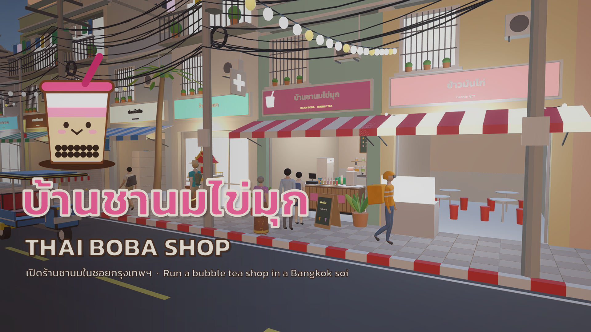

# Thai Boba Shop · บ้านชานมไข่มุก

A cozy first-person bubble tea shop simulator set in a Bangkok soi — by **Hoy Studio**.
เกมจำลองเปิดร้านชานมไข่มุกในซอยกรุงเทพฯ มุมมองบุคคลที่หนึ่ง

▶ **Play:** https://hoykhong.itch.io/thai-boba-shop (Windows · Android)

## Features
- Make every drink by hand: cup → tea → pearls → ice → sweetness → seal → serve, in any order
- 7 drinks, customer types with their own patience, tips and combos, daily goals and events, upgrades and restocking
- A living street: traffic with junctions and tunnels, pedestrians on both footpaths, umbrellas in the rain
- Day/night cycle synced to the in-game clock, seasons and weather (afternoon thunderstorms, wet glossy streets)
- Sloshing liquid shader, visible pearls per scoop, 3D vehicle and ambience sounds
- First-day tutorial, daily auto-saves, PC (mouse + keyboard) and touch controls
- Full **Thai / English** localisation

## Project
| | |
|---|---|
| Engine | Unity **6000.3.6f1**, URP, TextMeshPro, AI Navigation |
| Main scene | `Assets/Scenes/ThaiBobaStreet.unity` (generated by `Tools ▸ Thai Boba Shop ▸ Build Demo Scene`) |
| Game code | `Assets/Script/ThaiBoba/` (see `README_TH.md` there for every system) |
| Scene builder / release tools | `Assets/Script/ThaiBoba/Editor/` (`Tools ▸ Thai Boba Shop ▸ Release ▸ …`) |
| 3D assets | Generated in Blender 4.3 by `BlenderSource/thai_boba_assets.py` and `thai_npc_ps2.py` → `Assets/Models/ThaiBobaShop/` |
| UI art / icon | Generated in Illustrator by `ArtSource/UI/make_ui_kit.jsx` and `ArtSource/Branding/make_icon.jsx` |
| Store page kit | `Marketing/itch/` (cover, key art, screenshots, page text) |
| Tests | `Assets/Tests/ThaiBobaPlayMode` — PlayMode tests (Window ▸ General ▸ Test Runner) |

### ⚠️ Required: Joystick Pack (free, Asset Store)
The on-screen joystick uses **[Joystick Pack](https://assetstore.unity.com/packages/tools/input-management/joystick-pack-107631)** by Fenerax Studios.
Asset Store packages may not be redistributed, so it is **not in this repo**. After cloning:
1. Open the project in Unity 6000.3.6f1 (it will show compile errors about `Joystick` until step 2).
2. Window ▸ Package Manager ▸ My Assets ▸ **Joystick Pack** ▸ Download ▸ Import (into `Assets/Joystick Pack`).
3. Open `Assets/Scenes/ThaiBobaStreet.unity` and press Play.

### Building
- **Windows:** `Tools ▸ Thai Boba Shop ▸ Release ▸ Build Windows (x64)` → `Builds/Windows/`
- **Android:** switch platform to Android, then `Tools ▸ Thai Boba Shop ▸ Release ▸ Build Android (APK)` → `Builds/Android/`

## Credits
- Sounds: CC0 — [Kenney](https://kenney.nl), [OpenGameArt](https://opengameart.org), [BigSoundBank](https://bigsoundbank.com) (details in `Assets/Audio/ThaiBoba/CREDITS.txt`)
- Fonts: Kanit & Sarabun — SIL Open Font License 1.1 (`Assets/Fonts/Thai/OFL-*.txt`)
- Joystick Pack — Fenerax Studios (Unity Asset Store, not included)
